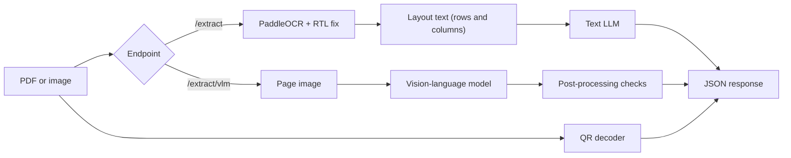

# FatoorahAI

**Bilingual (Arabic / English) invoice extraction API.** Upload a sales or purchase invoice as a PDF or image and get structured JSON back: invoice number, customer name in both languages, dates, invoice type, line items and the e-invoicing QR code.

Built with FastAPI, PaddleOCR and a vision-language model, packaged with Docker. With a local model (Ollama), **no invoice data leaves your machine**, which matters for GDPR/DSGVO and regulated environments.

> The name comes from *fatoorah* (فاتورة), Arabic for "invoice".

---

## Features

- Accepts **PDF, PNG and JPG**; sales and purchase invoices
- **Two extraction pipelines** you can compare on the same file (see below)
- **Arabic OCR with a right-to-left fix**: PaddleOCR returns Arabic in visual order, so text is converted back to logical order
- **QR code decoding** (for example Saudi ZATCA e-invoices); the QR payload is returned as a string
- **Bilingual output** with separate `_en` and `_ar` fields: no translation, and `null` for anything that is not printed
- **Post-processing guards** that fix text placed in the wrong language field, normalize dates to `YYYY-MM-DD` and convert Arabic-Indic digits
- **Swappable LLM backend**: local model through Ollama, the Claude API, or any OpenAI-compatible endpoint, selected by configuration only
- Dockerized, with interactive API docs (Swagger UI)

## Architecture



| Pipeline | Flow | Good for |
|---|---|---|
| `/extract` | OCR, rebuild rows, text LLM | Clean documents, fast iteration, small models |
| `/extract/vlm` | Page image, vision model, checks | Mixed Arabic/English pages where OCR misreads Latin letters and digits |

## API endpoints

| Method | Path | Description |
|---|---|---|
| `GET` | `/health` | Liveness check |
| `POST` | `/ocr` | Image to OCR text lines (text, confidence, bounding box) plus QR code |
| `POST` | `/ocr/pdf` | Same for PDFs, page by page |
| `POST` | `/extract` | OCR + text LLM to invoice fields |
| `POST` | `/extract/vlm` | Vision model to bilingual invoice fields |

Interactive docs are available at `http://localhost:8000/docs`.

## Quick start

### Prerequisites

- [Docker Desktop](https://www.docker.com/products/docker-desktop/) (give it at least 8 GB of memory)
- [Ollama](https://ollama.com/download) installed **natively** on your machine

> **Why native Ollama?** Docker on macOS cannot use the Apple GPU. Running Ollama natively and the API in Docker is much faster than running everything in containers. On Linux and Windows you can also run Ollama in Docker with GPU support.

### 1. Clone

```bash
git clone https://github.com/waleed415/fatoorahai.git
cd fatoorahai
```

### 2. Prepare the models (once)

```bash
ollama pull qwen2.5:7b
ollama pull qwen2.5vl:7b

# larger context window so invoices are not truncated
cat > Modelfile.text <<'EOF'
FROM qwen2.5:7b
PARAMETER num_ctx 8192
PARAMETER temperature 0
EOF
ollama create qwen2.5-invoice -f Modelfile.text

cat > Modelfile.vlm <<'EOF'
FROM qwen2.5vl:7b
PARAMETER num_ctx 8192
PARAMETER temperature 0
EOF
ollama create qwen2.5vl-invoice -f Modelfile.vlm
```

Other models work too: set the names in `.env`. Check each model's license before using it.

### 3. Configure

```bash
cp .env.example .env
```

### 4. Run

```bash
docker compose up --build
```

The first start downloads the PaddleOCR models, which takes a few minutes. Wait for `Application startup complete`, then open <http://localhost:8000/docs>.

> On Linux, add `extra_hosts: ["host.docker.internal:host-gateway"]` to the `api` service so the container can reach Ollama on the host.

### 5. Try it

```bash
curl -X POST "http://localhost:8000/extract/vlm" -F "file=@invoice.pdf"
```

## Example response (`/extract/vlm`)

Illustrative output on a synthetic invoice:

```json
{
  "invoiceNumber": "INV/2022/00004",
  "customerName_en": null,
  "customerName_ar": "جود العطامي",
  "invoiceDate": "2022-02-25",
  "dueDate": "2022-04-11",
  "invoiceType": "sales",
  "lineItems": [
    {
      "description_en": "Product - A",
      "description_ar": "البيان - A",
      "quantity": 1,
      "unitPrice": 100,
      "total": 112.7
    }
  ],
  "filename": "invoice.png",
  "isQrCode": true,
  "qrCode": "ARfYrNin2KjYsSDYp9mE2LTZhdin2YTZigIP...",
  "warnings": []
}
```

| Field | Meaning |
|---|---|
| `invoiceNumber` | The invoice's own number (not the VAT/TIN or PO number) |
| `customerName_en` / `customerName_ar` | Buyer name as printed in each language; `null` if that language is not printed |
| `invoiceDate` / `dueDate` | ISO dates, or `null` |
| `invoiceType` | `sales`, `purchase`, `credit_note`, `debit_note` or `unknown` |
| `lineItems[]` | One entry per table row: bilingual description, quantity, unit price, line total |
| `isQrCode` / `qrCode` | Whether a QR code was found, and its raw payload |
| `warnings` | Missing fields, or corrections applied by the post-processing checks |

## Configuration

All settings are environment variables (see `.env.example`).

| Variable | Default | Description |
|---|---|---|
| `LLM_PROVIDER` | `anthropic` | `anthropic`, or `openai` for any OpenAI-compatible endpoint (including Ollama) |
| `LLM_BASE_URL` | empty | For Ollama in Docker on macOS or Windows: `http://host.docker.internal:11434/v1` |
| `LLM_MODEL` | empty | Text model name, for example `qwen2.5-invoice` |
| `LLM_API_KEY` | empty | Any value for Ollama; a real key for hosted APIs |
| `LLM_TIMEOUT` | `90` | Seconds to wait for the text model |
| `LLM_SCRIPT` | `all` | `latin` sends only the English part of the text to the model |
| `LLM_INPUT_MODE` | `layout` | `layout` keeps table rows; `plain` sends plain text |
| `VLM_MODEL` | `qwen2.5vl-invoice` | Vision model name |
| `VLM_MAX_SIDE` | `1600` | Page images are shrunk to this many pixels on the long side |
| `VLM_TIMEOUT` | `300` | Seconds to wait for the vision model |
| `OCR_MODE` | `single` | `single` uses the Arabic model only; `dual` adds an English pass (slower) |
| `OCR_MAX_SIDE` | `2000` | Large images are shrunk before OCR |

## Design notes

- **Rules were replaced by a model.** The first version matched hardcoded Arabic and English keywords. It broke on the first unseen label, so extraction moved to an LLM.
- **OCR alone misreads mixed pages.** The Arabic recognition model confuses Latin letters and digits inside Arabic documents (for example an invoice number read as Arabic letters). The vision pipeline reads the page image directly and avoids that step.
- **Prompts are not enough.** Models tend to translate between languages and fill gaps. The prompt forbids both, and code checks enforce it after the model: Arabic text is moved out of `_en` fields, English-only text out of `_ar` fields, empty rows are dropped.
- **GPU access shapes the deployment.** Ollama runs natively for GPU speed; the API runs in Docker and calls it through `host.docker.internal`.
- **The LLM backend is a configuration choice.** The same code runs against a local model or a hosted API.

## Known limitations

- Accuracy depends on the model and the scan quality. There is no published benchmark yet.
- A small local vision model can still translate or miss rows on long tables. Review `warnings` and the output on your own documents.
- Digital PDFs contain real text, but the pipelines currently render and read them as images instead of using the text layer.
- Only the first QR code found is returned, and it is returned as a raw string (no field decoding).
- The first request after startup is slow while models load.
- Multi-page invoices are limited by `max_pages` and the model's context window.

## Roadmap

- [ ] Read the PDF text layer first and use OCR only for scans and photos
- [ ] Pluggable OCR providers
- [ ] Decode ZATCA QR fields and cross-check them against the extracted values
- [ ] Arithmetic validation (quantity × rate = amount, line sums = invoice total)
- [ ] Taxable amount, tax and net amount per line
- [ ] Synthetic bilingual test invoices with expected JSON, and an accuracy table
- [ ] Automated tests and CI

## Project structure

```
app/
├── main.py                  # FastAPI app and OCR engine startup
├── core/config.py           # settings from environment variables
├── api/
│   ├── ocr.py               # POST /ocr
│   ├── pdf.py               # POST /ocr/pdf
│   ├── extract.py           # POST /extract
│   └── extract_vlm.py       # POST /extract/vlm
├── schemas/                 # Pydantic response models
└── services/
    ├── ocr_engine.py        # PaddleOCR wrapper (single and dual mode)
    ├── ocr_pipeline.py      # resize, OCR, RTL fix, reading order
    ├── pdf_loader.py        # PDF pages to images
    ├── qr_reader.py         # QR code detection
    ├── text_fix.py          # Arabic detection and direction fix
    ├── layout_text.py       # rebuild rows and columns for the text LLM
    ├── llm_extractor.py     # text LLM (Anthropic or OpenAI-compatible)
    ├── vlm_extractor.py     # vision model extraction
    └── bilingual.py         # post-processing checks
```

## Troubleshooting

| Problem | What to check |
|---|---|
| Requests hang, nothing in the logs | Set `OCR_MODE=single`, raise Docker's memory limit, and check `ollama ps`. Uvicorn only logs a request after it finishes |
| `502 ... model not found` | Run `ollama list`; the model name in `.env` must match exactly |
| `503` | A required setting (API key or model name) is missing |
| `No module named 'langchain.docstore'` | PaddleX needs LangChain 0.3.x; keep the pins in `requirements.txt` |
| Container cannot reach Ollama | Use `host.docker.internal` (and `extra_hosts` on Linux), and confirm Ollama is running |

## Privacy

- With a local model (Ollama), invoices are processed on your machine only.
- With a hosted LLM provider, invoice text or images are sent to that provider. Choose accordingly for confidential documents.
- Do not commit real invoices. Use synthetic or anonymized samples.

## Third-party components and licenses

Uses [PaddleOCR](https://github.com/PaddlePaddle/PaddleOCR), [FastAPI](https://fastapi.tiangolo.com/), [PyMuPDF](https://pymupdf.readthedocs.io/) (AGPL-3.0, check compatibility with your use), [zxing-cpp](https://github.com/zxing-cpp/zxing-cpp), [python-bidi](https://github.com/MeirKriheli/python-bidi) and [Ollama](https://ollama.com/). Each model you run has its own license, and licenses can differ between model sizes, so check them before commercial use.

## License

See the `LICENSE` file.

## Author

**Waleed Ur Rehaman**, Solution Architect / Lead .NET Engineer based in Riyadh.
[GitHub](https://github.com/waleed415) · [LinkedIn](https://www.linkedin.com/in/waleed-ur-rehman-bb7a8b3b/)
